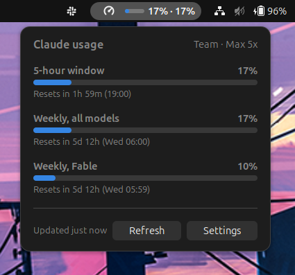

# AI Meter

GNOME Shell extension that shows your Claude Pro/Max usage in the top bar, next to the clock and battery.

<p align="center">
  
</p>

- **In the bar**: the 5-hour window as a percentage (optionally a small bar too). Amber from 70 %, red from 90 %, and a countdown to the reset once the window is used up.
- **On click**: the 5-hour window, the weekly limit, the per-model weekly limits when your plan has them, extra usage spend when enabled, each with a progress bar and its reset time, like the Claude Code VS Code extension's usage panel.
- **No setup**: it reuses the login of [Claude Code](https://docs.claude.com/en/docs/claude-code) on this machine. No API key, no extra sign-in.

Works on GNOME Shell 45 to 49 (Ubuntu 24.04 and later).

## Install

One line, no clone needed:

```sh
curl -fsSL https://raw.githubusercontent.com/rodibozman/ai-meter/main/install.sh | sh
```

Or from a clone:

```sh
git clone https://github.com/rodibozman/ai-meter.git
cd ai-meter
make install
```

Then **log out and back in** (GNOME on Wayland cannot reload extensions live). On an X11 session, `Alt+F2`, `r`, `Enter` is enough.

Requirements: `gnome-shell`, `glib-compile-schemas` (package `libglib2.0-dev-bin` on Ubuntu) and Claude Code signed in at least once (`claude` in a terminal).

You can also download the zip from the [Releases](https://github.com/rodibozman/ai-meter/releases) page and run `gnome-extensions install --force <zip>`.

## Settings

Click the indicator, then **Settings** (or use the Extensions app):

| Setting | Default | What it does |
| --- | --- | --- |
| Show | Percentage | Percentage, a small bar, or both, in the top bar |
| Show icon | on | The gauge icon before the number |
| Also show the weekly percentage | off | `12% · 40%` instead of `12%` |
| Position | 0 | Slot in the right-hand cluster of the bar, 0 = leftmost |
| Amber from / Red from | 70 / 90 | Color thresholds |
| Refresh every | 300 s | Poll interval, 150 s minimum. The dropdown also refreshes when opened and the data is older than that |
| Credentials file | `~/.claude/.credentials.json` | Where Claude Code stores its login |

## How it works

Claude Code stores an OAuth token in `~/.claude/.credentials.json` when you sign in. AI Meter reads that token and calls the same usage endpoint the `/usage` command of Claude Code calls, `https://api.anthropic.com/api/oauth/usage`. Nothing is written back, and nothing else leaves your machine.

The endpoint allows only a few calls per few minutes per account, and Claude Code polls it too (for its own usage display), so the extension never calls it more than once per 60 s, waits at least 5 minutes after a 429 (longer when `Retry-After` asks for it, and doubling while the 429s go on), and keeps showing the last values meanwhile.

When the token expires, the bar shows `expired`: open Claude Code (run `claude` in a terminal) and it renews the file; the meter picks it up on the next refresh. If the file is missing, the bar shows `no login`.

## Troubleshooting

- Logs: `journalctl -f -o cat /usr/bin/gnome-shell | grep ai-meter`
- Live check of the data path, without the Shell: `gjs -m test/fetch.js`
- The extension refuses to load after a GNOME upgrade: check that your `gnome-shell --version` is listed in `src/metadata.json`.

## Development

```sh
make check   # eslint, schema validation, unit tests (needs gjs)
make zip     # dist/ai-meter@rodibozman.github.io.shell-extension.zip
make uninstall
```

Sources live in `src/`. `usage.js` (fetch and parse) and `polling.js` (when to fetch, backoff) have no Shell dependency, so `make test` runs them offline under plain `gjs`: `test/parse.js` (parsing and formatting), `test/credentials.js` (the credentials file), `test/http.js` (every HTTP status, against a local server) and `test/polling.js` (refresh timing). `make lint` also runs shellcheck on `install.sh` when it is installed.

## License

MIT, see [LICENSE](LICENSE).
